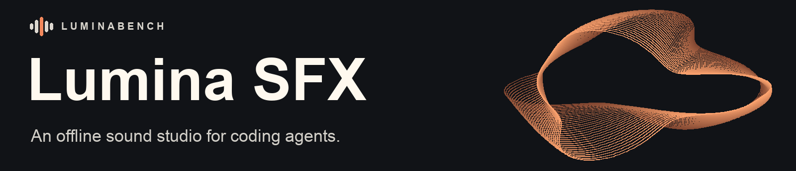
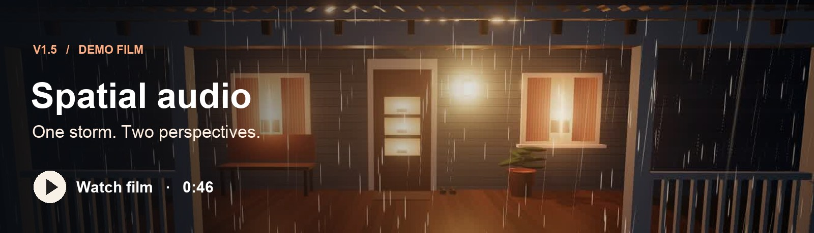

[](https://luminabench.github.io/lumina-sfx/)

**Headphones on.** Hear footsteps circle you, step out of the rain, then hear the same jet from the cockpit and the ground. [Watch the film](https://luminabench.github.io/lumina-sfx/) · [Try the soundboard](https://luminabench.com/skills/lumina-sfx/)

## Install

With Git and Node.js 22.20 or newer installed, run this and select your coding agent.

```sh
npx skills add LuminaBench/lumina-sfx -g
```

Open a fresh session in your project and describe what you want to hear. Your agent can shape and layer 2,882 editable effects, export a WAV, or wire sounds into your game.

<details>
<summary>Update, remove &amp; usage guides</summary>

Update your global installation, then open a fresh session.

```sh
npx skills update lumina-sfx -g
```

Remove the global skill.

```sh
npx skills remove lumina-sfx -g
```

[Agent guide](SKILL.md) · [Spatial audio](references/listening-scenes.md) · [Scoring a video](references/launch-audio.md)

</details>

## Licence

Render, modify and ship the sounds in personal and commercial games, apps, videos and demos, royalty-free, with no audio credit required. The library licence prohibits redistributing the collection as a competing sound pack, sample library, training dataset or agent skill. [Full terms, code licence and third-party notices](LICENSE)

[LuminaBench](https://luminabench.com) · [Sponsor the project](https://github.com/sponsors/LuminaBench)
